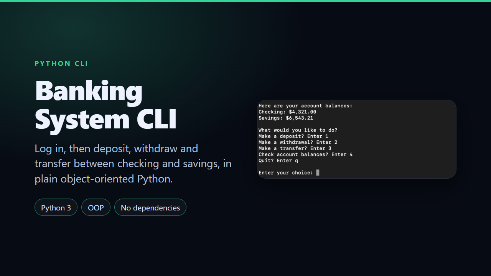

# Banking System CLI

[](https://github.com/PHTMGatt/22-Banking-System/actions/workflows/ci.yml)



A command-line banking app in plain Python, built around an object-oriented account design: log in, then deposit, withdraw and transfer between checking and savings.

## Status

Coursework project. Checked 2026-11-26 with Python 3.12: all files parse and `Main/main.py` starts at the login prompts; the money menu was not re-tested. No automated tests.

## What it does

- **Login checks:** the email must contain an `@`, and the password needs 8 or more characters with an uppercase letter, a lowercase letter, a digit and one of `!@#$%^&*`. You get 3 login attempts before the program exits.
- **Two accounts:** checking and savings both start from fixed demo balances ($4,321.00 and $6,543.21). Nothing is saved between runs and there is no real banking behind it.
- **Money moves:** deposit to either account, withdraw with a $100 overdraft allowance, and transfer in both directions.
- **Input handling:** bad menu choices, non-numeric amounts and overdraft errors re-prompt instead of crashing. Balances print as currency (`$4,321.00`).

## Tech stack

Python 3 only. No third-party packages.

## Run it

```bash
python3 Main/main.py
```

`Main/` is the commented version of the app. `Develop/` is an older, less-commented copy of the same app and is not the one to run.

A session starts like this:

```
Here are your account balances:
Checking: $4,321.00
Savings:  $6,543.21

What would you like to do?
Make a deposit? Enter 1
Make a withdrawal? Enter 2
Make a transfer? Enter 3
Check account balances? Enter 4
Quit? Enter q
```

More terminal screenshots (deposit, withdrawal, transfer, failed logins) are in the `Assets/` folder. There is no automated test suite.

## Structure

```
Main/
  main.py               entry point: login, menu loop
  BankingClasses/
    banking.py          abstract BankAccount base class
    checking.py         CheckingAccount
    savings.py          SavingsAccount
    validation.py       email and password checks
  BankingFunctions/
    deposit.py          deposit prompts
    withdraw.py         withdrawal prompts
    transfer.py         transfers and balance printout
```

## What I learned / built

- Object-oriented design in Python: an abstract base class with two account subclasses that share an interface.
- Validating user input and handling errors with exceptions so a typo never ends the session.
- Splitting a small program into classes and handler modules instead of one long script.
